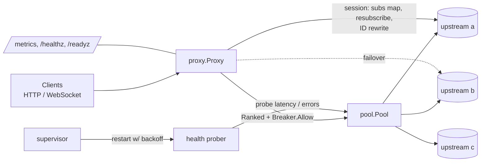

# rpc-failover-proxy

[](https://github.com/tommyshamamba/rpc-failover-proxy/actions/workflows/ci.yml)

A small Go proxy and library that puts several interchangeable upstreams behind one endpoint, for both HTTP and WebSocket. It probes health, ranks upstreams by smoothed latency, trips a circuit breaker on failures and fails over automatically. For WebSocket JSON-RPC streams, it also replays subscriptions on the new upstream, so clients keep their original subscription IDs.

It works with any JSON-over-HTTP or JSON-RPC-over-WebSocket upstream: internal APIs, pub/sub gateways or third-party providers. One example is a pool of blockchain node RPC providers. That's where the design came from, and the defaults use `eth_subscribe` and `web3_clientVersion`, which are configurable.

## Features
- **Health probing and ranking:** concurrent probes on an interval. Endpoints are ranked by EWMA latency, and an unmeasured endpoint ranks after every measured one.
- **Circuit breaker** per upstream, with closed, open and half-open states. Half-open admits a single trial request. Real traffic and probes both feed it.
- **HTTP failover:** retries on connection errors, timeouts, 429, 502, 503 and 504, up to `MaxAttempts` upstreams. Responses are buffered, so a client never receives half of a broken reply.
- **WebSocket failover with resubscribe:**
  - Pings detect silent hangs (two missed pongs).
  - On failover the proxy replays subscribe frames, maps new upstream subscription IDs back to the client's IDs and drops notifications for stale subscriptions.
  - In-flight requests get an explicit JSON-RPC error instead of hanging.
- **Supervised goroutines:** restart with capped, jittered exponential backoff and panic recovery.
- **Graceful shutdown:** on SIGTERM it drains HTTP and closes WebSocket sessions (which `http.Server.Shutdown` does not track), then stops background tasks.
- **Prometheus metrics** on a separate admin port, plus `/healthz` and `/readyz`. Logs are structured JSON via `log/slog`.

## Architecture


## Quick start
```sh
docker compose up --build
curl -s localhost:8545 -d '{"jsonrpc":"2.0","id":1,"method":"eth_blockNumber","params":[]}'
curl -s "localhost:9001/admin/fail?on=1"      # break upstream a
curl -si localhost:8545 -d '{"jsonrpc":"2.0","id":1,"method":"eth_blockNumber","params":[]}' | grep X-Upstream
curl -s localhost:9090/metrics | grep rfp_
```
To run without Docker:
```sh
go run ./cmd/fake-upstream -addr :9001 -name a &
go run ./cmd/fake-upstream -addr :9002 -name b &
go run ./cmd/rpc-failover-proxy -upstreams 'a=http://127.0.0.1:9001|ws://127.0.0.1:9001,b=http://127.0.0.1:9002|ws://127.0.0.1:9002'
```
Configuration uses flags or env vars: `RFP_UPSTREAMS`, `RFP_LISTEN`, `RFP_ADMIN_LISTEN`, `RFP_PROBE_BODY` and `RFP_LOG_LEVEL`. Run `-h` for the full list.

Kubernetes: [`deploy/k8s/proxy.yaml`](deploy/k8s/proxy.yaml) has a ConfigMap, a Deployment (non-root, read-only root FS, all capabilities dropped, liveness and readiness probes), a Service, an HPA and a PodDisruptionBudget.

## Use as a library
```go
p, _ := pool.New([]pool.Config{{Name: "a", HTTPURL: "http://a:8545", WSURL: "ws://a:8546"}}, pool.Options{})
sup := &supervisor.Supervisor{}
sup.Go(ctx, "prober", p.Run)
http.ListenAndServe(":8545", proxy.New(p, proxy.Options{}))
```

## Tests
```sh
go test -race ./...                       # unit, race and chaos tests
go test -run Chaos -v ./proxy             # prints measured failover times
go test -run '^$' -bench . ./proxy        # benchmarks
```
The chaos tests in `proxy/proxy_test.go` run three fake upstreams that stream a notification every 10 ms. They inject faults while a client is subscribed and assert that notifications resume from another upstream under the same subscription ID within a time budget:
- **Kill:** the upstream refuses connections and drops its sockets. Budget 500 ms.
- **Silent hang:** TCP stays open, but nothing is answered, including pings. Budget 750 ms with a 50 ms ping.
- **Rolling kills:** six consecutive failovers with recovering upstreams.

## Measured results
Measured on Oct 20, 2026 on a shared cloud VM: Intel Xeon (model not exposed), 8 vCPU, 15 GiB RAM, Linux amd64, Go 1.26.0, loopback networking, fake in-process upstreams. Other tenants were active, so treat these as rough numbers, not a lab benchmark.

| Benchmark (`-cpu 8 -benchtime 3s`) | Result |
|---|---|
| HTTP direct to fake upstream (baseline, parallel) | 10.0 µs/op |
| HTTP through proxy, 3 upstreams (parallel) | 21.9 µs/op (≈ +12 µs proxy overhead per request) |
| HTTP through proxy, sequential round trip | p50 80 µs, p99 388 µs |
| WebSocket notification subscription-ID rewrite | 8.4 µs/op, 3,090 B/op, 58 allocs/op |

| Chaos test (worst of 5 runs) | Time to first notification from a new upstream |
|---|---|
| Upstream killed | ≈ 12 ms |
| Upstream silently hung (ping 50 ms) | ≈ 112 ms (bounded by 2 × ping interval) |

The ID rewrite cost is only paid after a failover that changed the ID. See [DESIGN.md](DESIGN.md) for why it uses generic JSON maps and how it could be made cheaper.

## Status
This is a portfolio project. It has not been deployed in production by the author.

License: MIT
